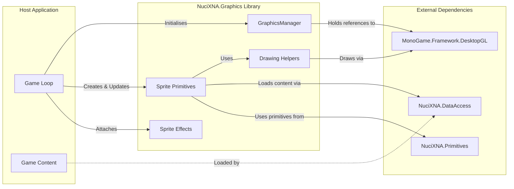
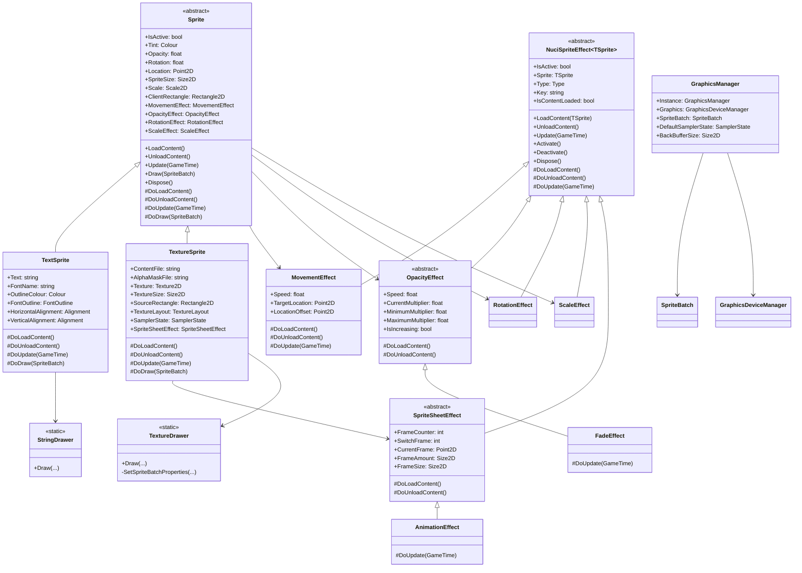
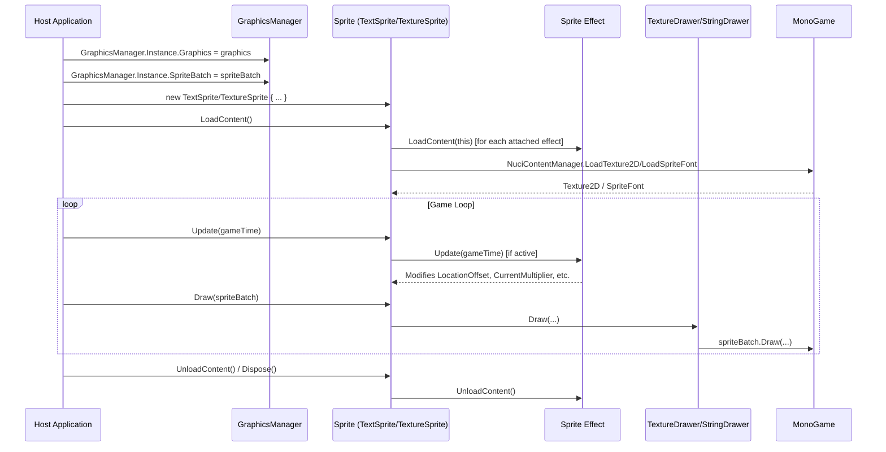
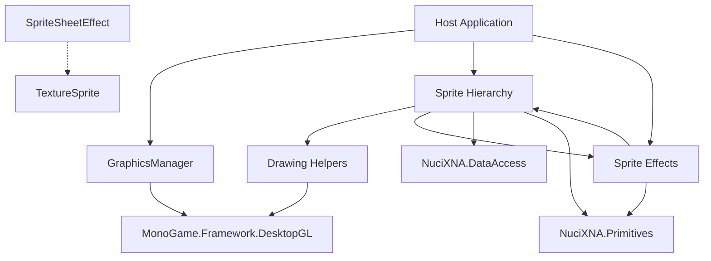

# NuciXNA.Graphics Architecture

This document describes the current architecture of NuciXNA.Graphics, a .NET class library for MonoGame/XNA graphics rendering. It covers the library's public contracts, internal modules, dependency direction, and extension points.

## 📑 Table of Contents

- [Purpose](#purpose)
- [System Context](#system-context)
- [Architectural Style](#architectural-style)
- [Runtime Flow](#runtime-flow)
- [Components](#components)
- [Architectural Areas](#architectural-areas)
- [Data Architecture](#data-architecture)
- [Interfaces and Integrations](#interfaces-and-integrations)
- [Dependency Direction and Rules](#dependency-direction-and-rules)
- [External Dependencies](#external-dependencies)
- [Deployment and Operations](#deployment-and-operations)
- [Compatibility Contracts](#compatibility-contracts)
- [Testing and Verification](#testing-and-verification)
- [Design Constraints](#design-constraints)
- [Extension Points](#extension-points)
- [Source Map](#source-map)
- [Related Documentation](#related-documentation)

## 🎯 Purpose

NuciXNA.Graphics provides reusable graphics primitives and sprite abstractions for MonoGame/XNA applications. Its principal responsibilities are:

- Centralised graphics context management via `GraphicsManager`
- Drawable sprite primitives (`TextSprite`, `TextureSprite`) with alignment, word wrapping, outlines, and texture layout modes
- Reusable sprite effects (movement, animation, opacity, scale, rotation, sprite sheet animation)
- Content loading integration via `NuciContentManager` from NuciXNA.DataAccess

The library targets game developers building 2D games with MonoGame DesktopGL. It is distributed as a NuGet package (`NuciXNA.Graphics`) and has no runtime dependencies beyond MonoGame and its sibling NuciXNA packages.

## 🌐 System Context

The principal external boundaries are:

- **MonoGame.Framework.DesktopGL:** Provides `GraphicsDevice`, `GraphicsDeviceManager`, `SpriteBatch`, `Texture2D`, `SpriteFont`, and rendering primitives. NuciXNA.Graphics wraps and extends these types.
- **NuciXNA.DataAccess:** Provides `NuciContentManager` for loading textures and fonts from game content. NuciXNA.Graphics depends on this for all content loading.
- **NuciXNA.Primitives:** Provides `Point2D`, `Size2D`, `Scale2D`, `Colour`, `Rectangle2D`, and mapping extensions. NuciXNA.Graphics uses these throughout its public API.
- **Host Application:** The game that references NuciXNA.Graphics. It owns the game loop, content pipeline, and `GraphicsDeviceManager`/`SpriteBatch` instances passed to `GraphicsManager`.

## 🏗️ Architectural Style

NuciXNA.Graphics follows a **library/SDK architecture** with these characteristics:

- **Public contract stability:** Public APIs (`GraphicsManager`, `Sprite`, `TextSprite`, `TextureSprite`, effect classes) are designed for consumption by host applications. Breaking changes require major version increments.
- **Internal module separation:** Drawing primitives, sprite effects, and drawing helpers are in separate namespaces/directories with minimal cross-coupling.
- **Dependency inversion toward abstractions:** `Sprite` and `NuciSpriteEffect<TSprite>` are abstract base classes; concrete implementations (`TextSprite`, `TextureSprite`, `MovementEffect`, etc.) depend on them, not vice versa.
- **Composition over inheritance for effects:** Sprites compose effects via properties (`MovementEffect`, `OpacityEffect`, etc.) rather than inheriting effect behaviour.
- **Stateless drawing helpers:** `TextureDrawer` and `StringDrawer` are static utility classes with no retained state.

The principal architecture boundaries are:

- **GraphicsManager (Singleton):** Owns the `GraphicsDeviceManager` and `SpriteBatch` references. Initialised once by the host application before any sprite operations.
- **Sprite Hierarchy (`Sprite` → `TextSprite`/`TextureSprite`):** Base class defines the lifecycle (`LoadContent`, `Update`, `Draw`, `Dispose`) and effect composition. Concrete sprites implement rendering-specific logic.
- **Effect Hierarchy (`NuciSpriteEffect<TSprite>` → concrete effects):** Effects are attached to sprites, loaded/unloaded with the sprite, and updated per frame when active. They modify sprite rendering parameters (location, opacity, rotation, scale, source rectangle).
- **Drawing Helpers (`TextureDrawer`, `StringDrawer`):** Stateless utilities that encapsulate `SpriteBatch` drawing logic, sampler state management, text alignment, wrapping, and outlines.

## 🔄 Runtime Flow

The principal runtime sequence is:

1. **Initialisation:** Host application assigns `GraphicsDeviceManager` and `SpriteBatch` to `GraphicsManager.Instance`.
2. **Sprite Creation & Content Loading:** Host creates sprite instances, sets properties, calls `LoadContent()`. Sprites load textures/fonts via `NuciContentManager`; effects load with the sprite.
3. **Per-Frame Update:** Host calls `sprite.Update(gameTime)`; sprite updates active effects which modify rendering parameters (offsets, multipliers).
4. **Per-Frame Draw:** Host calls `sprite.Draw(spriteBatch)`; sprite delegates to `TextureDrawer` or `StringDrawer` which issue `SpriteBatch.Draw` calls.
5. **Cleanup:** Host calls `UnloadContent()` or `Dispose()`; sprite and effects release resources.

## 🧩 Components

| Component | Responsibility | Principal Dependencies | Lifetime or Ownership |
|-----------|----------------|------------------------|-----------------------|
| `GraphicsManager` | Singleton holder for `GraphicsDeviceManager` and `SpriteBatch`; provides `DefaultSamplerState` and `BackBufferSize` | `MonoGame.Framework.DesktopGL` | Singleton; initialised by host, lives for application lifetime |
| `Sprite` (abstract) | Base lifecycle (`LoadContent`, `Update`, `Draw`, `Dispose`), effect composition, common properties (location, tint, opacity, rotation, scale) | `NuciXNA.Primitives`, `NuciXNA.Graphics.SpriteEffects` | Created by host; owned by host; disposed by host |
| `TextSprite` | Renders text with alignment, word wrapping, outlines | `Sprite`, `NuciXNA.DataAccess` (NuciContentManager), `StringDrawer`, `MonoGame.Framework.DesktopGL` | Created by host; owned by host |
| `TextureSprite` | Renders textures with layout modes (Stretch, Tile, Centre, Zoom), alpha masking, sprite sheet support | `Sprite`, `NuciXNA.DataAccess`, `TextureDrawer`, `MonoGame.Framework.DesktopGL` | Created by host; owned by host |
| `MovementEffect` | Moves sprite toward a target location at constant speed | `NuciSpriteEffect<Sprite>`, `NuciXNA.Primitives` | Attached to sprite; loaded/unloaded with sprite |
| `FadeEffect` | Oscillates opacity multiplier between min/max | `OpacityEffect` | Attached to sprite; loaded/unloaded with sprite |
| `RotationEffect` | Modifies sprite rotation over time | `NuciSpriteEffect<Sprite>` | Attached to sprite; loaded/unloaded with sprite |
| `ScaleEffect` | Modifies sprite scale over time | `NuciSpriteEffect<Sprite>` | Attached to sprite; loaded/unloaded with sprite |
| `AnimationEffect` | Advances sprite sheet frame based on elapsed time | `SpriteSheetEffect` | Attached to `TextureSprite`; loaded/unloaded with sprite |
| `SpriteSheetEffect` (abstract) | Base for sprite sheet frame calculation | `NuciSpriteEffect<TextureSprite>` | Attached to `TextureSprite` |
| `TextureDrawer` | Static helper: draws textures with sampler state management for Stretch/Tile layouts | `MonoGame.Framework.DesktopGL`, `GraphicsManager` | Stateless; no lifetime |
| `StringDrawer` | Static helper: draws strings with alignment, wrapping, outlines | `MonoGame.Framework.DesktopGL` | Stateless; no lifetime |

## 🗂️ Architectural Areas

### Drawing Primitives

Paths:
- `NuciXNA.Graphics/Drawing/Sprite.cs`
- `NuciXNA.Graphics/Drawing/TextSprite.cs`
- `NuciXNA.Graphics/Drawing/TextureSprite.cs`
- `NuciXNA.Graphics/Drawing/TextureDrawer.cs`
- `NuciXNA.Graphics/Drawing/StringDrawer.cs`
- `NuciXNA.Graphics/Drawing/Alignment.cs`
- `NuciXNA.Graphics/Drawing/FontOutline.cs`
- `NuciXNA.Graphics/Drawing/TextureLayout.cs`

Responsibilities:
- Define the `Sprite` base class and its lifecycle contract
- Implement `TextSprite` and `TextureSprite` concrete renderables
- Provide stateless drawing utilities (`TextureDrawer`, `StringDrawer`)
- Define enums for alignment, outline style, texture layout

Boundary rules:
- Drawing primitives depend on `NuciXNA.Primitives` and `NuciXNA.DataAccess` but not on `SpriteEffects`
- `TextureDrawer` and `StringDrawer` have no dependencies on sprite or effect types
- `Sprite` references effect types only as properties (composition), not as base classes

### Sprite Effects

Paths:
- `NuciXNA.Graphics/SpriteEffects/NuciSpriteEffect.cs`
- `NuciXNA.Graphics/SpriteEffects/MovementEffect.cs`
- `NuciXNA.Graphics/SpriteEffects/OpacityEffect.cs`
- `NuciXNA.Graphics/SpriteEffects/FadeEffect.cs`
- `NuciXNA.Graphics/SpriteEffects/RotationEffect.cs`
- `NuciXNA.Graphics/SpriteEffects/ScaleEffect.cs`
- `NuciXNA.Graphics/SpriteEffects/SpriteSheetEffect.cs`
- `NuciXNA.Graphics/SpriteEffects/AnimationEffect.cs`
- `NuciXNA.Graphics/SpriteEffects/ZoomEffect.cs`
- `NuciXNA.Graphics/SpriteEffects/OscilationEffect.cs`

Responsibilities:
- Define the `NuciSpriteEffect<TSprite>` base class with activation/deactivation and lifecycle
- Implement concrete effects for movement, opacity, rotation, scale, sprite sheet animation
- Effects modify sprite rendering parameters during `Update`

Boundary rules:
- Effects depend on `Sprite` (or `TextureSprite` for `SpriteSheetEffect`) but sprites do not depend on concrete effect types
- Effects are generic over `TSprite` where `TSprite : Sprite`; `SpriteSheetEffect` constrains to `TextureSprite`
- Effects have no external dependencies beyond `NuciXNA.Primitives` and `MonoGame.Framework` (for `GameTime`)

### Graphics Manager

Paths:
- `NuciXNA.Graphics/GraphicsManager.cs`

Responsibilities:
- Singleton access to `GraphicsDeviceManager` and `SpriteBatch`
- Global `DefaultSamplerState` for `TextureDrawer`
- `BackBufferSize` convenience property

Boundary rules:
- No dependencies on `Drawing` or `SpriteEffects` namespaces
- Only depends on `MonoGame.Framework.DesktopGL` and `NuciXNA.Primitives`
- Initialised by host application before any sprite operations

## 💾 Data Architecture

NuciXNA.Graphics is a rendering library with **no persistent data ownership**. All data is transient, owned by the host application, and flows through the library per frame:

| Data or Store | Owner | Representation and Storage | Lifecycle or Consistency |
|---------------|-------|----------------------------|--------------------------|
| Sprite properties (Location, Tint, Opacity, Rotation, Scale, Text, ContentFile, etc.) | Host Application | CLR objects on managed heap | Host-controlled; mutated per frame or via effects |
| Effect state (LocationOffset, CurrentMultiplier, CurrentFrame, FrameCounter, IsActive) | Effect Instance | CLR objects on managed heap | Created on `LoadContent`; updated per `Update`; cleared on `UnloadContent`/`Deactivate` |
| Loaded textures (`Texture2D`) | Host Application (via `NuciContentManager`) | GPU memory + managed wrapper | Loaded on `LoadContent`; released on `UnloadContent`/`Dispose` |
| Loaded fonts (`SpriteFont`) | Host Application (via `NuciContentManager`) | GPU memory + managed wrapper | Loaded on `LoadContent`; released on `UnloadContent`/`Dispose` |
| `GraphicsManager.Graphics` / `SpriteBatch` | Host Application | Managed references to MonoGame objects | Assigned once at startup; held for application lifetime |

No caching, persistence, or cross-session state exists in the library.

## 🔌 Interfaces and Integrations

| Interface or Integration | Direction | Contract | Owner | Failure Semantics |
|--------------------------|-----------|----------|-------|-------------------|
| `GraphicsManager.Instance.Graphics` / `SpriteBatch` | Inbound (host → library) | `GraphicsDeviceManager`, `SpriteBatch` from MonoGame | Host Application | `InvalidOperationException` if accessed before assignment |
| `NuciContentManager.Instance.LoadTexture2D` / `LoadSpriteFont` | Outbound (library → NuciXNA.DataAccess) | String content path → `Texture2D` / `SpriteFont` | NuciXNA.DataAccess | Propagates `ContentLoadException` or `FileNotFoundException` |
| `Sprite.LoadContent()` / `UnloadContent()` / `Update()` / `Draw()` | Inbound (host → library) | Lifecycle contract: must call `LoadContent` before `Update`/`Draw`; `UnloadContent`/`Dispose` for cleanup | NuciXNA.Graphics | `InvalidOperationException` if called out of order |
| `Sprite.MovementEffect` / `OpacityEffect` / etc. | Inbound (host → library) | Property assignment of effect instances; effects loaded with sprite | NuciXNA.Graphics | `InvalidOperationException` if effect not loaded |
| `TextureDrawer.Draw()` / `StringDrawer.Draw()` | Internal (sprite → drawer) | Drawing parameters → `SpriteBatch.Draw` calls | NuciXNA.Graphics | Propagates MonoGame exceptions |

## 🔀 Dependency Direction and Rules

**Permitted dependency directions:**
- Host Application → NuciXNA.Graphics (all public APIs)
- `Sprite` → `NuciSpriteEffect<TSprite>` (composition via properties)
- `TextureSprite` → `SpriteSheetEffect` (constrained generic)
- `Sprite`/`TextureSprite` → `TextureDrawer`/`StringDrawer` (static helpers)
- `Sprite`/`TextureSprite` → `NuciContentManager` (content loading)
- All → `NuciXNA.Primitives` (primitive types)
- All → `MonoGame.Framework.DesktopGL` (rendering substrate)

**Prohibited couplings:**
- `SpriteEffects` → `Drawing` (no references to `TextSprite`, `TextureSprite`, `TextureDrawer`, `StringDrawer`)
- `Drawing` → `SpriteEffects` (except `Sprite` property declarations for effect composition)
- `GraphicsManager` → `Drawing` or `SpriteEffects`
- Circular dependencies between any namespaces

## 📦 External Dependencies

| Dependency | Version | Purpose | Architectural Responsibility |
|------------|---------|---------|------------------------------|
| `MonoGame.Framework.DesktopGL` | 3.8.4 | Rendering substrate: `GraphicsDevice`, `SpriteBatch`, `Texture2D`, `SpriteFont`, `GameTime`, `SamplerState` | Provides all GPU/drawing primitives; library wraps but does not abstract |
| `NuciXNA.DataAccess` | 4.0.3 | Content loading via `NuciContentManager` | Sole content-loading integration; library has no direct `ContentManager` usage |
| `NuciXNA.Primitives` | 2.1.7 | `Point2D`, `Size2D`, `Scale2D`, `Colour`, `Rectangle2D`, mapping extensions | All public API types; no MonoGame vector/color types in public surface |

No other external dependencies (no HTTP, logging, configuration, DI containers, etc.).

## 🚀 Deployment and Operations

- **Deployment model:** NuGet package (`NuciXNA.Graphics`) consumed by host applications at build time. No runtime deployment artefact.
- **Process topology:** In-process library within the host MonoGame application. No separate processes, services, or network endpoints.
- **Persistent state:** None. All state is host-owned and in-memory.
- **Scaling assumptions:** Single-threaded render loop (MonoGame `Game` class). Library is not thread-safe; host must synchronise if calling from multiple threads.
- **Operational consequences:** Host application controls content pipeline, `GraphicsDevice` lifecycle, and game loop. Library imposes no operational requirements beyond .NET 10 and MonoGame DesktopGL compatibility.

## 🔒 Compatibility Contracts

| Contract | Owner | Invariant | Verification Method | Change Policy |
|----------|-------|-----------|---------------------|---------------|
| Public API surface (`GraphicsManager`, `Sprite`, `TextSprite`, `TextureSprite`, all effect classes, enums) | NuciXNA.Graphics | No breaking changes within major version | Compile-time verification via consumer builds; unit tests | Semantic versioning: breaking changes → major version |
| `GraphicsManager` singleton initialisation order | Host Application | `Graphics` and `SpriteBatch` must be assigned before any `LoadContent`/`Draw` | Runtime `InvalidOperationException` guard | Documented; not enforced by library |
| Sprite lifecycle (`LoadContent` → `Update`/`Draw` → `UnloadContent`/`Dispose`) | NuciXNA.Graphics | Methods throw `InvalidOperationException` if called out of order | Unit tests (`SpriteTests`) | Stable; exceptions are part of contract |
| Effect attachment (`Sprite.MovementEffect = new MovementEffect()`) | Host Application | Effect must be assigned before `sprite.LoadContent()` | Runtime guard in `Sprite.LoadContent` | Stable |
| NuGet package versioning | NuciXNA.Graphics | Follows SemVer 2.0 | `dotnet pack` + CI | Automated via GitHub Actions |

## 🧪 Testing and Verification

| Test Boundary | Tool | Command | Coverage Focus |
|---------------|------|---------|----------------|
| Unit tests (sprite effects, drawing logic) | NUnit 4.6.1 + NUnit3TestAdapter | `dotnet test NuciXNA.Graphics.slnx` | Effect state transitions, `TextureDrawer` sampler logic, `StringDrawer` alignment/wrapping |
| Build verification | .NET SDK 10 | `dotnet build NuciXNA.Graphics/NuciXNA.Graphics.csproj` | Compilation, dependency resolution |
| Pack verification | .NET SDK 10 | `dotnet pack NuciXNA.Graphics/NuciXNA.Graphics.csproj -c Release` | NuGet package contents, version, metadata |

**Material coverage gaps:**
- No integration tests with real `GraphicsDevice` (requires headless GPU or MonoGame test harness)
- No visual regression tests
- No performance benchmarks

**Prohibitions:**
- Tests must not require a visible window or interactive GPU context
- Tests must not depend on external network resources

## ⚙️ Design Constraints

| Constraint | Description | Rationale |
|------------|-------------|-----------|
| .NET 10 target | `TargetFramework=net10.0` in `.csproj` | Aligns with NuciXNA ecosystem; uses modern C# features |
| MonoGame DesktopGL only | `MonoGame.Framework.DesktopGL` package reference | Cross-platform desktop focus; no WindowsDX, iOS, Android variants in this package |
| No `ContentManager` direct usage | All content loading via `NuciContentManager` | Centralises content loading in NuciXNA.DataAccess; enables testing and abstraction |
| Singleton `GraphicsManager` | `static Instance` with double-checked locking | Single `GraphicsDevice`/`SpriteBatch` per MonoGame application; matches MonoGame patterns |
| Effect composition via properties | `Sprite.MovementEffect`, `OpacityEffect`, etc. | Allows optional effects; avoids deep inheritance hierarchies |
| Static drawing helpers | `TextureDrawer`, `StringDrawer` are `static` | Stateless; no allocation per draw call; easy to test in isolation |
| `IDisposable` on `Sprite` and `NuciSpriteEffect` | Finalizer + `Dispose(bool)` pattern | Ensures content unload even if host forgets `UnloadContent` |
| GPL-3.0-or-later license | `PackageLicenseExpression` in `.csproj` | Copyleft; host applications must comply |

## 🔌 Extension Points

| Extension Point | Contract | Registration / Integration Location |
|-----------------|----------|-------------------------------------|
| Custom sprite types | Inherit from `Sprite`; implement `DoLoadContent`, `DoUnloadContent`, `DoUpdate`, `DoDraw` | Host application creates instances directly |
| Custom sprite effects | Inherit from `NuciSpriteEffect<TSprite>`; implement `DoLoadContent`, `DoUnloadContent`, `DoUpdate` | Assign to `Sprite.MovementEffect`, `OpacityEffect`, `RotationEffect`, `ScaleEffect`, or `TextureSprite.SpriteSheetEffect` |
| Custom texture layout | Extend `TextureLayout` enum (requires library modification) | Not currently extensible without fork; `TextureDrawer` handles all cases |
| Custom sampler state | Set `TextureSprite.SamplerState` or `GraphicsManager.DefaultSamplerState` | Per-sprite or global override |
| Custom content loading | Replace `NuciContentManager.Instance` implementation | NuciXNA.DataAccess extension point; not in this library |

## 📂 Source Map

| Area | Repository-Relative Paths |
|------|---------------------------|
| Graphics Manager | `NuciXNA.Graphics/GraphicsManager.cs` |
| Drawing Primitives | `NuciXNA.Graphics/Drawing/` |
| Sprite Effects | `NuciXNA.Graphics/SpriteEffects/` |
| Unit Tests | `NuciXNA.Graphics.UnitTests/` |
| Solution / Build | `NuciXNA.Graphics.slnx`, `NuciXNA.Graphics/NuciXNA.Graphics.csproj`, `NuciXNA.Graphics.UnitTests/NuciXNA.Graphics.UnitTests.csproj` |

## 📚 Related Documentation

- [README.md](README.md) — Overview, usage, installation, project structure
- [SECURITY.md](SECURITY.md) — Vulnerability reporting and disclosure policy
- [PRIVACY.md](PRIVACY.md) — Data handling description (no personal data collected)
- [LICENSE](LICENSE) — GNU GPL v3.0 or later
- [NuciXNA.DataAccess](https://github.com/hmlendea/nucixna.dataaccess) — Content loading dependency
- [NuciXNA.Primitives](https://github.com/hmlendea/nucixna.primitives) — Primitive types dependency